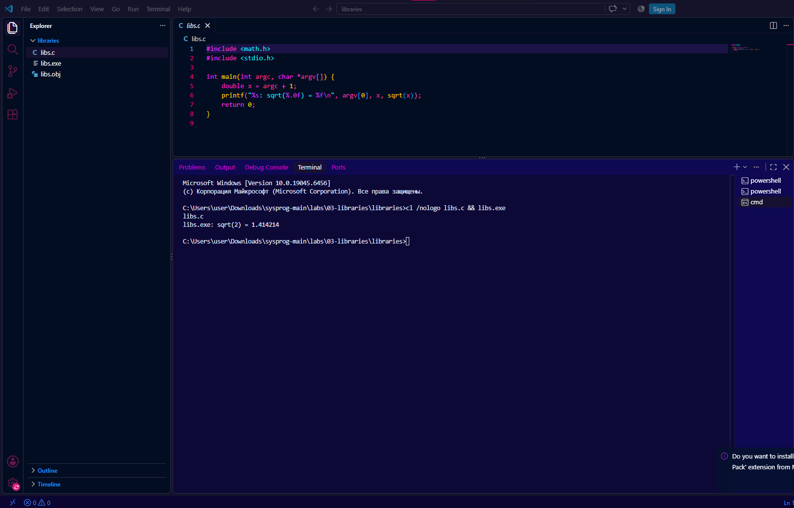
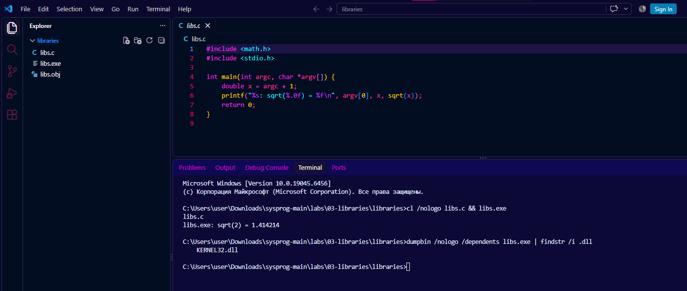
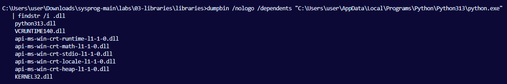
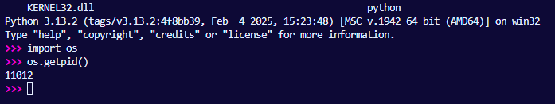
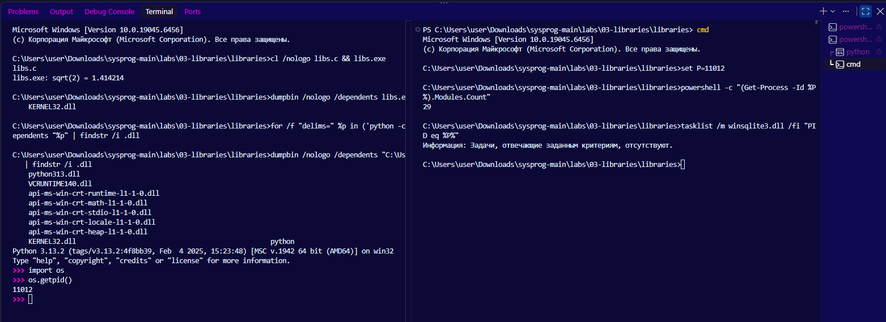
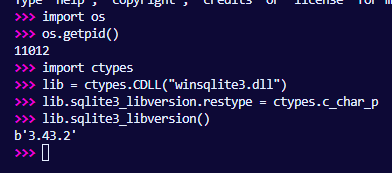
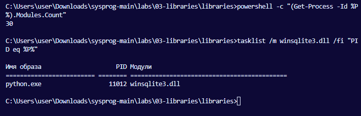

# ЛР 3. Библиотеки программы

Система: Windows 10 · отладчик: Visual Studio (LLDB, GDB или Visual Studio)

## Библиотеки файла
Программа напечатала: libs.exe: sqrt(2) = 1.414214
Команда для списка библиотек файла: dumpbin /nologo /dependents libs.exe | findstr /i .dll
Библиотеки libs: KERNEL32.dll
Почему в списке нет отдельной математической библиотеки (или почему она есть): в Windows математические функции (sqrt) входят в C runtime, а cl по умолчанию (/MT) подключает CRT статически, поэтому код sqrt лежит прямо внутри libs.exe и отдельной DLL не нужно
Где лежит интерпретатор Python (файл или библиотека): python.exe (C:\Users\user\AppData\Local\Programs\Python\Python313\python.exe) — только запускает, сам интерпретатор лежит в библиотеке python313.dll

## Библиотеки процесса
PID Python: 11012
Библиотек в процессе до ctypes.CDLL: 29, после: 30
Загруженная библиотека и её полный путь: winsqlite3.dll — C:\Windows\System32\winsqlite3.dll
Функция вернула: b'3.43.2' (sqlite3_libversion)

Не получилось: все получилось.

## Снимки экрана

### 1. Сборка и запуск
Шаг 1. Видно: команда сборки и строка `sqrt(2) = 1.414214`.

### 2. Библиотеки файла libs
Шаг 2. Видно: вывод `dumpbin /dependents` / `otool -L` / `ldd` для своей программы.

### 3. Библиотеки интерпретатора Python
Шаг 3. Видно: тот же вывод для файла Python.

### 4. Номер процесса Python
Шаг 4. Видно: запущенный Python и его номер процесса.

### 5. Библиотеки процесса до загрузки
Шаг 5. Видно: число библиотек процесса Python до `ctypes.CDLL`.

### 6. Библиотека загружена
Шаг 6. Видно: строка `ctypes.CDLL` и результат вызова функции библиотеки.

### 7. Библиотеки процесса после загрузки
Шаг 7. Видно: новое число библиотек и строка загруженной библиотеки.

