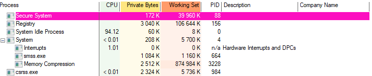
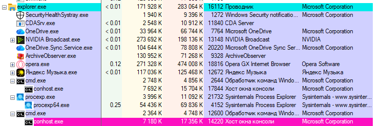
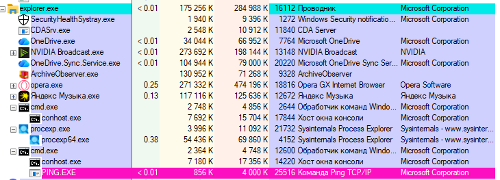
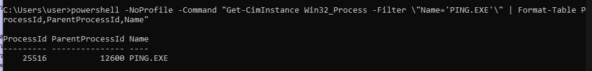
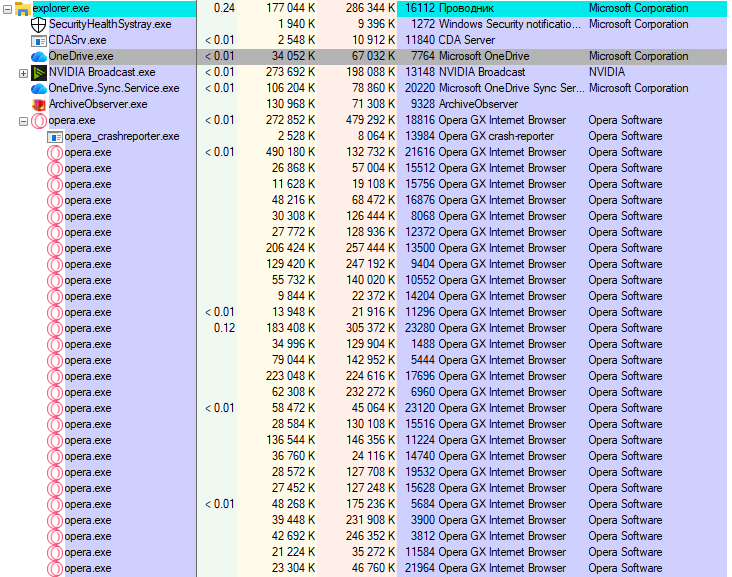
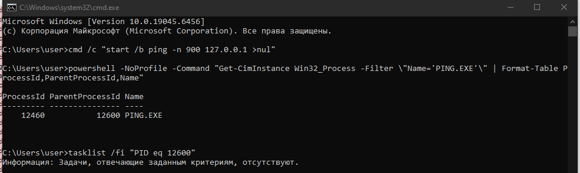
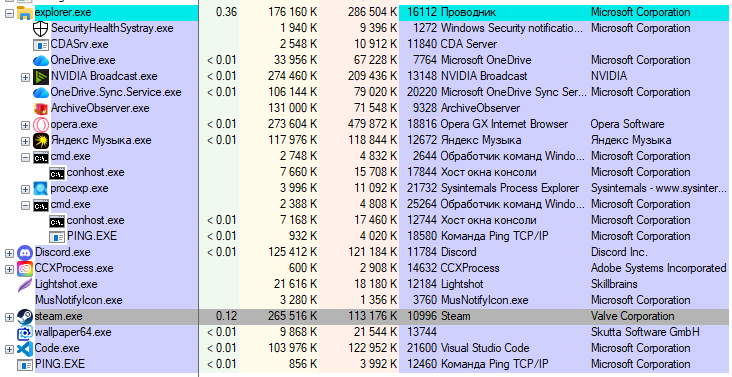

# ЛР 4. Дерево процессов

Система: Windows 10 (10.0.19045) · монитор: Process Explorer

## Дерево
Процесс в начале дерева и его номер: System Idle Process (PID 0) и System (PID 4); рядом в корне Secure System (88), Registry (156), под System — smss.exe (664)
Цепочка родителей терминала (имя и номер): cmd.exe (12600) → explorer.exe (16112) → корень дерева (родитель explorer.exe, userinit.exe, уже завершился)
Дочерний процесс: номер 25516 (PING.EXE), родитель 12600 (cmd.exe)
Команда, которой проверен родитель: powershell -NoProfile -Command "Get-CimInstance Win32_Process -Filter \"Name='PING.EXE'\" | Format-Table ProcessId,ParentProcessId,Name"
Процессов у браузера и имя процесса вкладок: Opera GX — около 29 процессов (главный opera.exe 18816, opera_crashreporter.exe и 27 дочерних opera.exe); вкладки работают в процессах opera.exe

## Сирота
Номер сироты: 12460 (PING.EXE)
Номер родителя до и после завершения настоящего родителя: 12600 и 12600 — в Windows номер родителя не меняется, но процесса 12600 уже нет (tasklist /fi "PID eq 12600" ничего не находит)
Где сирота стоит в дереве: в корне дерева, отдельно внизу списка, а не под cmd.exe

Не получилось: все получилось.

## Снимки экрана

Папка `screenshots/`.

### 1. Начало дерева процессов
Шаг 1. Видно: дерево процессов в мониторе: первые процессы системы и их номера.

### 2. Терминал и его родители
Шаг 2. Видно: ветка дерева от процесса терминала вверх до процесса системы.

### 3. Дочерний процесс терминала
Шаг 3. Видно: запущенный из терминала процесс под оболочкой терминала.

### 4. Родитель по команде
Шаг 4. Видно: вывод команды с номером процесса и номером его родителя.

### 5. Процессы браузера
Шаг 5. Видно: раскрытая ветка браузера с дочерними процессами.

### 6. Процесс без родителя
Шаг 6. Видно: команда запуска и номер родителя у оставшегося процесса.

### 7. Сирота в дереве
Шаг 7. Видно: тот же процесс в дереве монитора на новом месте.

