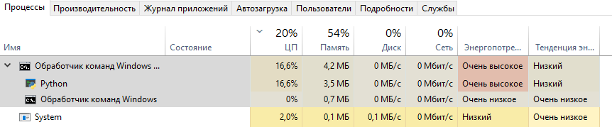
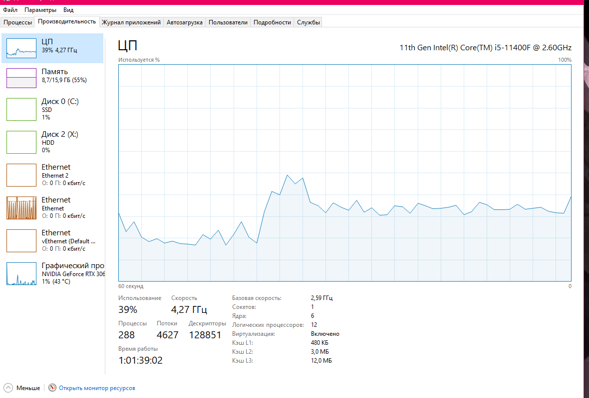
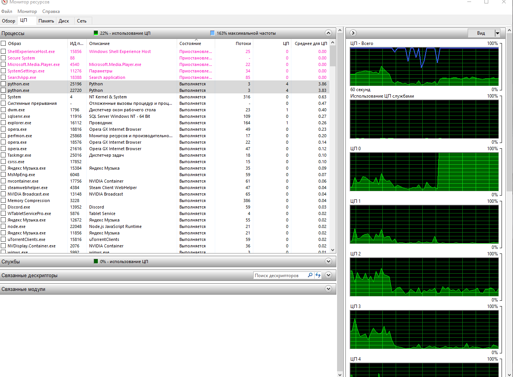
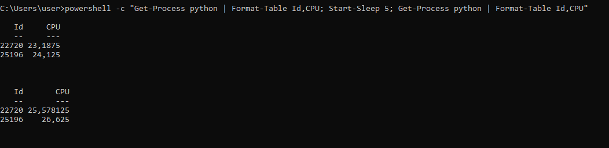

# ЛР 6. Кто загружает процессор

Система: Windows 10, Intel Core i5-11400F
Ядер (логических процессоров): 6 ядер, 12 логических процессоров

## Одна нагрузка
Процент процесса в мониторе: 16,6%
Общая загрузка: 20%
На каких ядрах видна нагрузка: на разных, планировщик перекидывает процесс между ядрами

## Две нагрузки
Проценты обеих нагрузок и общая загрузка: 15,1% и 15,1%, общая 39%
На одном ядре (в macOS — фоновый режим): оба Python на ЦП 0 (он загружен на 100%), у каждого около 4% (среднее 3,86 и 3,83), то есть делят одно ядро пополам

## Процессорное время
Первый замер, второй замер, пауза: PID 22720: 23,19 → 25,58 с; PID 25196: 24,13 → 26,63 с; пауза 5 с
Загрузка по замерам: примерно 2,4 и 2,5 с за 5 с, то есть по ~50% одного ядра у каждого
Почему процент в мониторе не говорит о скорости работы: процент показывает только долю процессорного времени. Он не учитывает частоту ядра (она меняется, видно 163% от максимальной) и то, сколько полезной работы сделано за это время

Не получилось: все получилось.

## Снимки экрана

Папка `screenshots/`.

### 1. Одна нагрузка
Шаг 1. Видно: процесс Python в мониторе: его процент и общая загрузка.

### 2. Две нагрузки
Шаг 3. Видно: два процесса Python и загрузка ядер.

### 3. Нагрузки на одном ядре
Шаг 4. Видно: две нагрузки на одном ядре и их проценты; в macOS — два числа оборотов цикла.

### 4. Процессорное время
Шаг 5. Видно: два замера процессорного времени с паузой между ними.

