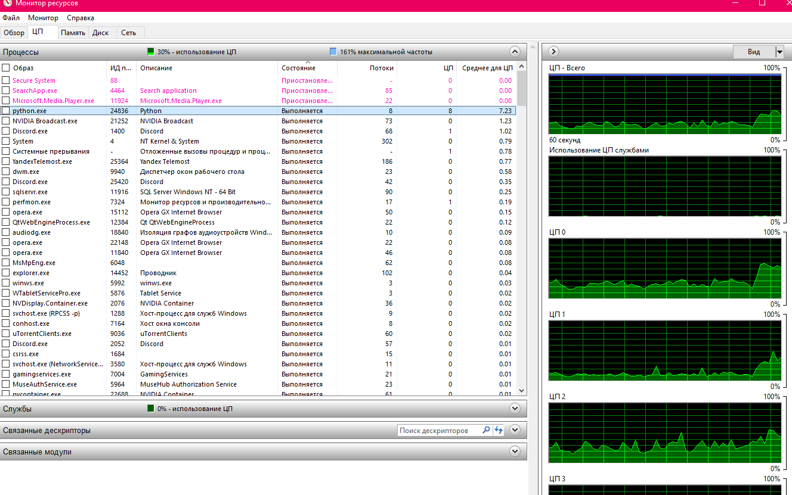
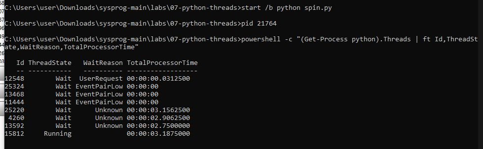
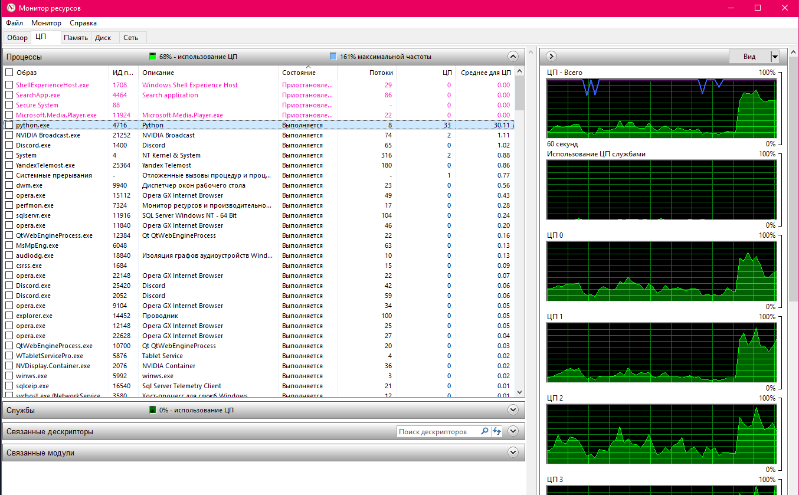
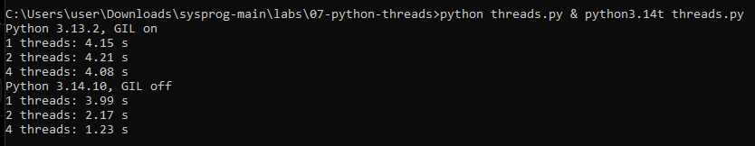

# ЛР 7. Потоки Python и GIL

Система: Windows 10, Intel Core i5-11400F
Ядер (логических процессоров): 6 ядер, 12 логических процессоров
Версии Python (обычный и без GIL): Python 3.13.2 (GIL on) и Python 3.14.10 free-threaded (python3.14t, GIL off)

## Python с GIL
Процент процесса и число потоков: python.exe — 8% (среднее 7,23%), 8 потоков
Сколько потоков выполняется одновременно: 1 (Running только один, три рабочих потока в Wait — ждут GIL)

## Python без GIL
Процент процесса и проценты потоков: ~33% (4 ядра из 12), каждый из 4 потоков ~8% (по целому ядру)

## Время работы
С GIL, 1 / 2 / 4 потока: 4,15 / 4,21 / 4,08 с
Без GIL, 1 / 2 / 4 потока: 3,99 / 2,17 / 1,23 с
Без GIL с PYTHON_GIL=1: ~4 / ~4 / ~4 с (как с GIL)
Ожидание, 1 и 4 потока: ~2,00 и ~2,00 с
Почему ожидающие потоки ускоряются и с GIL: во время sleep поток отпускает GIL, поэтому все 4 спят одновременно и общее время равно 2 с, а не 8

Не получилось: все получилось.

## Снимки экрана

Сохраните снимок поверх заглушки в папке `screenshots/` с тем же именем — ссылки ниже менять не нужно.

### 1. Четыре потока с GIL
Шаг 1. Видно: процесс Python в мониторе: его процент и число потоков.

### 2. Потоки процесса
Шаг 2. Видно: список потоков процесса: сколько выполняется, сколько ждёт.

### 3. Четыре потока без GIL
Шаг 3. Видно: процесс python3.14t в мониторе: его процент.

### 4. Время работы
Шаг 4. Видно: вывод threads.py в Python с GIL и без.

